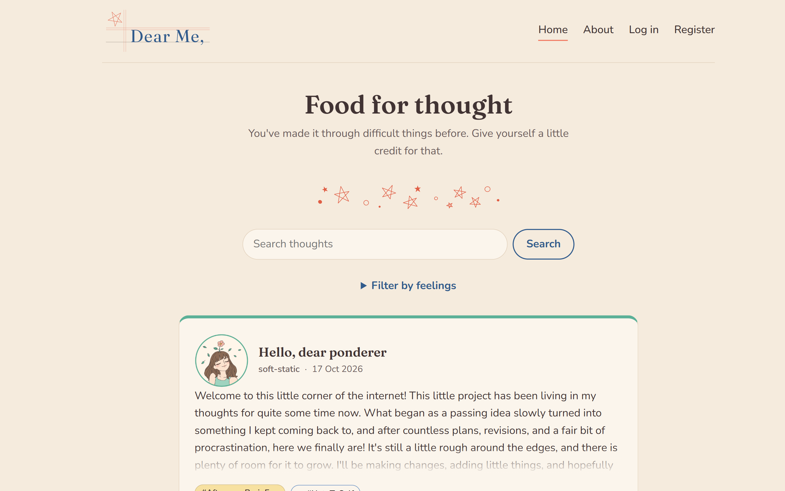
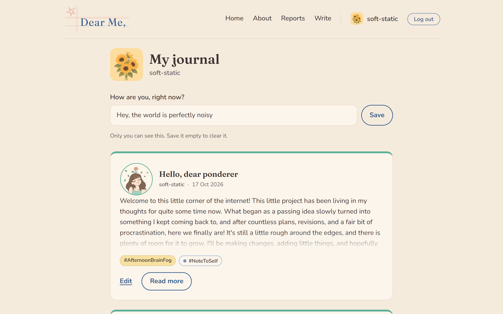
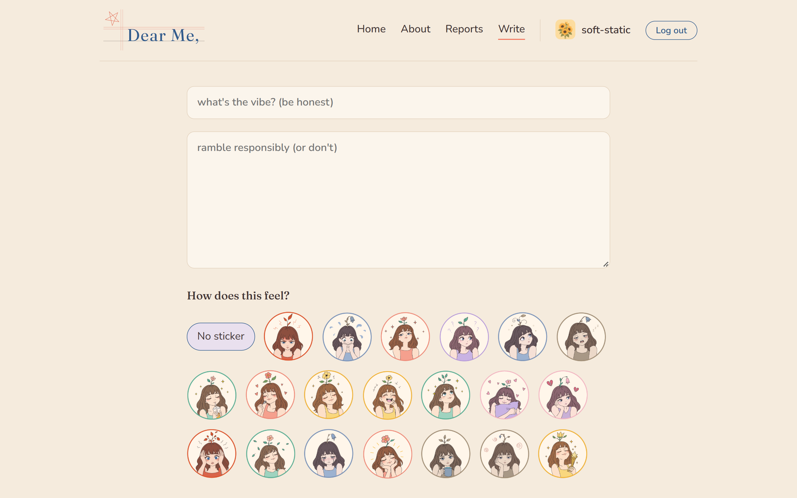
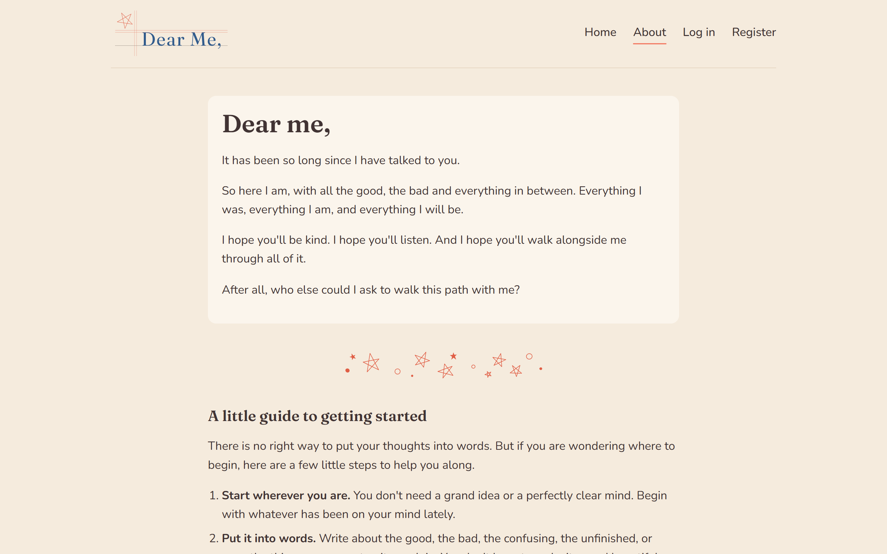

# Dear Me,

> A quiet place to put your thoughts into words.

**Live site:** https://dear-me-production.up.railway.app









## About

Dear Me is a small journaling and thoughts-dump website where people can write under a pseudonym, keep their posts private or share them publicly, and tag each post with how they were feeling. No email, no real names, no pressure.

It began as a capstone project for a course, and it grew well beyond the brief into a full-stack app with accounts, moderation, and a security layer I built up piece by piece. I wanted to build a place where a person can write up their thoughts and feelings- not necessarily to share with others, just for themselves. A place where they can be honest with themselves.

## Features

**Writing**
- Create posts that are **private by default** or public
- Optional **mood sticker** on each post (angry, anxious, hopeful, in my soft era, and more)
- Optional time-of-day tag, up to 3 topic tags, and a **content warning** field
- Edit or delete your own posts at any time

**Reading**
- Home feed of public posts, filterable by **mood** or **tag**
- **Search** and pagination
- Posts show their mood sticker, tags and content warning

**Your space**
- Register with just a pseudonym, a password and an avatar
- A personal **profile page** listing all your posts, private ones included
- A short **status line** you can update any time

**Accounts and privacy**
- No email required. A one-time **recovery code** is shown at signup and is the only way to reset a forgotten password
- Private posts are invisible to everyone else, and nobody can edit or delete a post that isn't theirs
- **Delete your account** (password required) and your posts and sessions are removed with it

**Community care**
- Readers can **report** a post with a reason, including "I'm worried about the writer," which points them to help resources
- An admin-only page for reviewing, dismissing or removing reported posts

**Polish**
- Custom, illustrated error pages (403, 404, 429, 500)
- Fonts are self-hosted, so the site makes no third-party requests

## Security notes

This is a public app that stores people's private writing, so I treated security as part of the build, not an afterthought:

- Passwords hashed with **bcrypt**; login and password recovery do the same amount of work whether or not the account exists
- Session is regenerated on login; cookies are `httpOnly`, `sameSite=lax` and `secure` in production; sessions are stored in SQLite
- **CSRF protection** using the browser's `Sec-Fetch-Site` and `Origin` headers on every state-changing request
- **Helmet** for security headers, with a strict Content Security Policy
- **Rate limiting** on login, register, password recovery, posting, reporting and account deletion, plus a loose app-wide limit
- All database access uses prepared statements; all form input is type-checked and length-checked on the server
- Case-insensitive unique pseudonyms enforced at the database level

## Built with

|        Area       |                    Tools                                      |
|        ---        |                     ---                                       |
|       Server      |                Node.js, Express                               |
|     Templates     |                     EJS                                       |
|      Database     |                    SQLite (Node's built-in `node:sqlite`), with a custom session store |
| Auth and security |      bcrypt, express-session, helmet, express-rate-limit      |
|      Design       |           Hand-written CSS, Fraunces, Nunito Sans,            |
|                   |           illustrations made in Adobe Illustrator             |
|     Hosting       |                    Railway                                    |

## Run it locally

You'll need **Node.js 22.13 or newer**.

```bash
git clone https://github.com/ank-8818/dear-me.git
cd dear-me
npm install
```

Create a `.env` file (or set these in your shell):

|       Variable      | Purpose                                                                     |
|         ---         | ---                                                                         |
|   `SESSION_SECRET`  | Required. Any long random string                                            |
| `ADMIN_PSEUDONYM`   | Optional. The pseudonym that gets access to the reports page. Register that account first |
| `DATABASE_PATH`     | Optional. Where the SQLite file lives (defaults to `dear-me.db`)            |
| `NODE_ENV`          | Set to `production` when deploying, so cookies are marked `secure`          |
| `PORT`              | Optional. Defaults to 3000                                                  |

Then start it:

```bash
npm start
```

and open http://localhost:3000.

## Project structure

```
app.js            routes, middleware, rate limiters
db.js             schema and database connection
users.js          user queries
data.js           post queries
reports.js        reporting and moderation queries
recovery.js       recovery code generation and checking
sessionStore.js   SQLite-backed session store
views/            EJS templates
public/           CSS, images, stickers
```

## Design decisions

- **No email on purpose.** A journaling site works best when people feel anonymous, so recovery works through a code instead.
- **Private by default.** Writing something public should be a choice, not an accident.
- **Moods are optional.** Not every thought fits a feeling, and the form never forces one.
- **The color palette is chosen deliberately.** It is warm, approachable, and feels soothing.
- **If some thoughts are too heavy for this page, please refer to the About section.** You are allowed to take a break, be kind to yourself.

## What I learned

When I started this project, I thought it would be small and quickly done. I didn't imagine the scope would grow so much. I had only just learned Node and Express and dove nose-first into this — which is why I got stuck, struggled, but eventually made it through. The most challenging parts were building authentication and sessions, thinking through security measures, paginating posts, working with SQLite, and making sure the logic in each module worked correctly. Eventually deploying it on Railway tied it all together. It has been a long journey.

## Credits

- Mood stickers, logo, favicon and divider designed by me in Adobe Illustrator
- Profile avatars: Images created in ChatGPT
- Fonts: Fraunces, Nunito Sans (obtained through Google Fonts)
